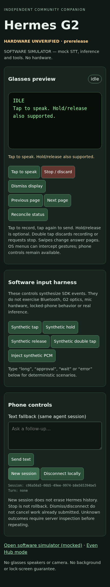

# Hermes ↔ Even G2

**HARDWARE UNVERIFIED · independent community prerelease · not an official Even Realities or Nous Research product.**

Voice in, text out: an open-source Even Hub companion plus a native Hermes Agent plugin. Explicit G2 temple / optional R1 gestures capture a bounded utterance; your private broker transcribes it and submits a real Hermes run. Tools, skills, memory and approval policy stay on your configured Hermes server. Answers are paginated on the glasses. There are no glasses speakers or camera.

This is a software-qualified preview, not a claim of tested glasses, Bluetooth, locked-iPhone operation, or live speech recognition. A separate bounded real Anthropic inference run executed a real harmless Hermes terminal tool; the composed software harness still uses explicitly labeled model/STT fixtures. See the [evidence matrix](docs/verification.md) and [hardware checklist](docs/hardware-checklist.md).

## What is included

- Real SDK 0.0.16 companion, not a proprietary/unavailable client.
- Native directory plugin: `hermes even-g2 check` and `hermes even-g2 serve`. Import/registration does not launch services.
- Explicit capture, 30-second ceiling, text fallback, contextual follow-ups, progress, errors, paging and new sessions.
- Phone-only full-request approval (`once` or `deny`), bound to canonical pending prompt and execution generation. No glasses auto-approval.
- Backend-acknowledged cancellation, durable intent deduplication and status-only reconnection. Stop is not rollback.
- Exact-origin HTTPS, per-device revocable tokens, no phone-side Hermes/provider credential, no telemetry or local conversation database.
- Deterministic simulator and a composed software test through the real public Hermes runtime. Mocked STT/model/Even hardware are explicitly labeled.

## Compatibility

| Component | Supported / tested scope |
|---|---|
| Hermes Agent | **0.22.5 only**, manifest `>=0.22.5,<0.22.6`; broker also checks server version |
| Python | 3.14; same isolated runtime as public Hermes v0.22.5 |
| Node | 22.12+ (Node 22 LTS recommended) |
| Even Hub SDK / CLI | pinned 0.0.16 / 0.2.0 |
| Even App | documented minimum **2.2.10**; hardware validation pending |
| Phone | iPhone primary target; Android unverified |
| Hardware | G2 required for actual use; R1 optional; all physical behavior unverified |

## Quick start

1. Use a dedicated least-privilege Hermes 0.22.5 profile with its authenticated API server on loopback. Keep its tools/approval policy intact. [Install/configuration](docs/install.md).
2. Install this plugin with the supported Hermes plugin mechanism (pin the release's exact commit for reproducibility):
   ```sh
   hermes plugins install NolanGarrett/hermes-even-g2 --enable
   ```
   The GitHub release's plugin ZIP is an alternative directory install; it is not a PyPI package.
   Accept the dependency prompt; unattended installs require explicit `--yes-deps`. Verify the plugin is enabled, not merely downloaded.
3. Configure the broker's exact trusted WebView origin and device token hash. Supply `EVEN_G2_BACKEND_KEY` and, for a remote STT provider, `EVEN_G2_STT_KEY` in the server process environment. Never put these keys into the companion.
4. Run `hermes even-g2 check`, then explicitly run `hermes even-g2 serve` behind your private HTTPS reverse proxy. This project does not configure your VPN, TLS, firewall or service manager.
5. Clone/download the source, set your broker's exact HTTPS origin in `companion/app.json` network whitelist, and build:
   ```sh
   cd companion
   npm ci
   npm run build
   npm run pack
   ```
6. Enroll in Even Hub and install your deployment-specific package using the [build/beta guide](docs/even-hub.md). Enter only your revocable device token on the phone. Keep the app foregrounded until hardware gates pass.

Release companion assets use the reserved `https://g2.example.com` origin. They are valid **deployment templates**, not a hosted service and not a universally connectable package. Rebuild with your exact origin; weakening the whitelist is not a setup shortcut.

## Try it without glasses

```sh
cd companion
npm ci
npm run dev
```

Open `http://127.0.0.1:5173/?simulator=1`. The clearly labeled simulator makes **no STT, model or tool calls**. Tap to listen, inject synthetic PCM, tap to send. Type `long`, `approval`, `wait` or `error` for scenarios. This is not a Bluetooth or iPhone background simulator.



## Read before giving it tools

The narrow device token prevents cross-device session access; it does **not** sandbox your agent. Anyone holding it can ask that configured agent to act. A VPN is not authentication. Speech and model content remain untrusted. Use a restricted profile, preserve approvals, and revoke a lost device promptly.

Unknown submission outcomes deliberately block retries. Dismiss/disconnect do not cancel an existing run. New session does not erase history. The companion stores only resume IDs (and pending stop intent); Hermes and your STT provider have their own retention. No seamless attachment to existing CLI/Desktop conversations is claimed.

- [Architecture and official sources](docs/architecture.md)
- [Install, upgrade, removal and troubleshooting](docs/install.md)
- [Private network, TLS and authentication](docs/deployment.md)
- [Even enrollment, packaging, beta and optional native endpoint](docs/even-hub.md)
- [Privacy, sessions and control semantics](docs/privacy-controls.md)
- [Evidence, tests, development and release](docs/verification.md)
- [Hardware acceptance checklist](docs/hardware-checklist.md)
- [Security policy](SECURITY.md) · [Third-party notices](THIRD_PARTY_NOTICES.md) · [Changelog](CHANGELOG.md)

Original source: MIT. See [LICENSE](LICENSE). No OcuClaw implementation was copied.
